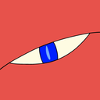

# PokeUDS

PokeUDS trades with retail Pokemon games on a Nintendo 3DS over local wireless (UDS), the way
[pokeldn](https://github.com/Decryptu/pokeldn) does for the Switch. A computer with an ESP32 board (S3, C3, C6; alpha: classic) or a USB Wi-Fi
adapter stands in for a second console: the 3DS sees another player and trades with it. Nothing is installed on the
3DS. It can also send Gen 6 and Gen 7 Mystery Gifts over local wireless, the way an event distribution did.

**Status: alpha.** Trades have run against retail 3DS consoles for the Virtual Console games, Pokemon X/Y and Sun/Moon.
A Gen 6 local-wireless Mystery Gift has been received by a retail X. A Gen 7 local-wireless Mystery Gift has been
received by a retail Sun.

| Game | Trades start in | Record | PokeUDS joins | PokeUDS hosts | Tested with a 3DS |
|---|---|---|:---:|:---:|---|
| Red / Blue / Yellow (VC) | VC link menu, Trade Center | `.pk1` (or `.pk2` through the Time Capsule) | ✓ | ✓ | ✓ both directions, Gen 1 with Gen 1 |
| Gold / Silver / Crystal (VC) | VC link menu, Trade Center or Time Capsule | `.pk2` with mail (or `.pk1`) | ✓ | ✓ | ✓ both directions, Gen 2 with Gen 2 |
| X / Y | PSS | `.pk6` | ✓ | ✓ | ✓ both directions |
| Omega Ruby / Alpha Sapphire | PSS | `.pk6` | ✓ | ✓ | uses X/Y's values |
| Sun / Moon | Festival Plaza | `.pk7` | ✓ | ✓ | ✓ both directions |
| Ultra Sun / Ultra Moon | Festival Plaza | `.pk7` | ✓ | ✓ | uses Sun/Moon's values |

The VC rows cover every release: English, German, French, Spanish, Italian, Japanese (Green too) and Korean Gold
and Silver, each with its own trade blocks, and a Pokemon from one language is offered to a console of another with
its names carried over ([docs/vc.md](docs/vc.md), Languages). Only the English games have been tried with a 3DS so
far; the others are built from the cartridges' layouts and await testing confirmation against real hardware.

Local trades never cross a generation (Sun/Moon and USUM trade with each other, as do X/Y and ORAS); Gen 1 and Gen 2
meet in the Time Capsule. To move a Pokemon forward, the Bank migrates Gen 1/2 and Gen 6 Pokemon to Gen 7 the way
Poke Transporter and Pokemon Bank do.

## What it does

- **Trade** with the 3DS asking PokeUDS or PokeUDS asking the 3DS, one Pokemon or a queue of them in one session
  (up to six for the Game Boy games, a box's worth and more for the 3DS games).
- **Touch Trade, experimental**, for trade evolutions: PokeUDS offers back whatever the 3DS offers, so the 3DS
  receives its own Pokemon and evolves it, in every game ([docs/cli.md](docs/cli.md#trading)).
- **Bank** every Pokemon received, imported or built: legality checks with PKHeX (one or the whole bank), Time
  Capsule copies, migration to Gen 7, duplicates caught, sprites.
- **Build** a legal Pokemon to offer when you have no file (PKHeX.Core, built into the app), with the IVs and EVs
  (DVs and stat experience in Gen 1/2) and Hidden Power you want, or import a Showdown or Smogon set (a whole team
  too) and build from it.
- **Mystery Gift**: PKHeX's official Gen 6/7 cards, `.wc6`/`.wc7` and full files, and a card editor (every field,
  saved as `.udsgift`, exported as `.wc6`/`.wc7`). A card's Pokemon can go into the bank and a trade, or the card
  itself goes out over local wireless as an event distribution did:
  - **Gen 6** (X/Y, ORAS): no extra key; the gift is CRC-checked only.
  - **Gen 7** (Sun/Moon, USUM): the game checks the distributor's OPSSR signature, so PokeUDS signs each card with
    the distributor app's private key. That key is not shipped: the **Gen 7 Mystery Gift Key** card in Settings
    reads it from your own dump of the Gen 7 Local Distributor (00040000001A8900) and keeps it in `rsa_d_key.txt`
    beside `aes_keys.txt`. Retail game dumps hold only the public key.
- **DS Mystery Gifts (Gen 4/5)**: Diamond, Pearl, Platinum, HeartGold, SoulSilver, Black, White, Black 2 and
  White 2 receive PKHeX's official cards, or a Pokemon or item card you build, over DS local wireless, as a store
  distribution sent them: the Gifts page's Nintendo DS game, on the same board and firmware. Working: Gen 4 on a
  retail DS, a custom Gen 4 item card from the builder included; Gen 5 confirmed by Shinygati, whose sender PokeUDS's
  is ported from, along with custom cards of both generations made with their own tools
  ([docs/mystery_gift.md](docs/mystery_gift.md)).
- **GTS**: list a banked Pokemon against what you want, or offer on someone else's listing, bank to bank over
  public Nostr relays; a trade settles when the lister's app next opens ([docs/online.md](docs/online.md)).
- **Online trades, experimental**: X/Y, ORAS, Sun/Moon, USUM and the Virtual Console games trade live with a player
  far away, each 3DS beside its own PokeUDS and board, through the same relays: each 3DS is offered the other's
  Pokemon, and each trades only once both have said yes ([docs/online.md](docs/online.md)). Tested in simulation;
  **not yet tried with two real 3DSs**.
- **Board**: install the ESP32 firmware (included, nothing to download) from the app.
- **Plugins and language packs**, with an install screen that shows what a plugin's code does.

## Getting it

Download the app for your computer from the [releases](https://github.com/Gr3nSkyDragon/PokeUDS/releases). The
apps carry everything, PKHeX included: nothing else to install or download.

**Windows:** download `PokeUDS-windows.zip`, unzip it anywhere you can write (Documents, the Desktop, a USB
drive) and run `PokeUDS/PokeUDS.exe`.

Everything the app keeps stays in its own folder: your Pokemon in `PokeUDS/Bank`, received files in
`PokeUDS/received`, and its settings, sprites and plugins in `PokeUDS/Data` (hidden). Nothing is written to your
user profile, and the app will not write outside its folder: if it cannot write there, it says so and asks you to
move the folder. An earlier version's files in `%APPDATA%\PokeUDS` are copied over on the first start and left
where they were. The zip holds none of these folders, so to update, unzip the new version over the old `PokeUDS`
folder: the app is replaced and your `Bank`, `Data` and `received` are left as they are. If you delete the old
folder instead, move them into the new one first. Two copies of the folder are two separate players (each with its
own bank, settings and GTS listings).

**Mac:** download `PokeUDS-macos-arm64.zip` for Apple Silicon (M1 or newer) or `PokeUDS-macos-x64.zip` for an Intel
Mac (Apple menu, About This Mac, says which), unzip it and move `PokeUDS.app` to Applications. The app is not
notarized by Apple, so the first time it is refused: open it once, then System Settings, Privacy & Security,
**Open Anyway**. Your Pokemon are kept in `~/Library/Application Support/PokeUDS/bank`, outside the app, so replacing
`PokeUDS.app` with a newer one leaves them alone (Settings can point the bank somewhere else).

**Linux:** there is no packaged app; run it from source, below.

**From source** (any OS, Python 3.11 or newer):

```bash
python -m venv .venv
```

```bash
.venv\Scripts\activate
```

```bash
pip install -r requirements-gui.txt
```

```bash
python -m gui
```

On macOS or Linux, activate with `. .venv/bin/activate`. To use PokeUDS from a terminal instead, see the
[command-line instructions](docs/cli.md).

## What you need

- **A radio** ([docs/hardware.md](docs/hardware.md)):
  - an **ESP32-S3** with [esp32-uds-bridge](https://github.com/Gr3nSkyDragon/VC-Adapter/tree/main/firmware/esp32-uds-bridge)
    firmware 2.1-uds, on its native USB port (PokeUDS includes it: the Board page installs it), or an ESP32-C3 or
    C6 the same way; **alpha**: a classic ESP32 ([docs/hardware.md](docs/hardware.md)); any OS; or
  - a **USB Wi-Fi adapter** through legacy **ldnd.exe 0.0.5** (Windows; not the ldnrs revision).
- **`aes_keys.txt`** holding the keyslot 0x2D key (`slot0x2DKeyN`, or `slot0x2DKeyX`, `slot0x2DKeyY` and
  `generatorConstant`): the same file Azahar uses. Set it once in Settings. Only scanning works without it.
- **For Gen 7 Mystery Gift distribution only:** a decrypted dump of the Gen 7 Local Distributor, as a CXI, a CCI
  (`.cci`/`.3ds`) or its `code.bin`, from which Settings extracts the signing key once
  ([docs/mystery_gift.md](docs/mystery_gift.md)).

## Trading

1. Settings: choose `aes_keys.txt`, and set your trainer (name, TID/SID) for Pokemon you build.
2. Trade: pick the game and the connection (ESP32 board or USB Wi-Fi adapter).
3. Add Pokemon to the trade queue: the **+** row picks from the bank, or Build one (or Import paste), or Add a file.
4. Pick whether PokeUDS joins or hosts, then Start, and follow the steps the page shows on the 3DS:
   - **VC games**: choose Host (or Join) in the VC link menu, then sit at the Trade Center table.
   - **X/Y, ORAS**: open the PSS with local wireless on, then ask PokeUDS for a trade (or accept its request).
   - **Sun/Moon, USUM**: open the Festival Plaza, then invite PokeUDS to a Link Trade (or accept its invite).

What the 3DS sends lands in the bank. [docs/gui.md](docs/gui.md) describes every page of the app.

## Sending a Mystery Gift

1. Gifts: pick an official card (PKHeX's list), open a `.wc6`/`.wc7`/full file, or make one in the editor.
2. For Sun/Moon or USUM, set up the Gen 7 Mystery Gift Key in Settings first (once).
3. Send over local wireless, then on the 3DS: Mystery Gift, Receive Gift, Get via Local Wireless.

## Documentation

| Topic | Guide |
|---|---|
| Every page of the app, updates | [The app](docs/gui.md) |
| Boards, firmware and USB Wi-Fi adapters | [Hardware](docs/hardware.md) |
| Building Pokemon, legality, Showdown sets | [PKHeX](docs/pkhex.md) |
| Mystery Gift cards and distributions | [Mystery Gift](docs/mystery_gift.md), [Wonder Cards](docs/wonder_cards.md) |
| The GTS | [Online and the GTS](docs/online.md) |
| Installing or writing plugins and language packs | [Plugins](docs/plugins.md) |
| Using PokeUDS from a terminal | [Command-line instructions](docs/cli.md) |
| Code layout and tests | [Architecture](docs/architecture.md) |
| Local wireless protocols and captures | [UDS](docs/uds.md), [Gen 6](docs/gen6.md), [Gen 7](docs/gen7.md), [Virtual Console](docs/vc.md), [captures](docs/captures.md) |
| Building a release, and the planned code signing | [Releases](docs/release.md), [code signing](docs/code_signing.md) |

## Credits

PokeUDS follows [pokeldn](https://github.com/Decryptu/pokeldn) by [Decryptu](https://github.com/Decryptu), which
does the same for the Switch: the app's shape and design, its PKHeX integration and updater, and code taken from it
under the AGPL-3.0. pokeldn is a fork of
[MercuryEnigma/frlg-ldn-trade](https://github.com/MercuryEnigma/frlg-ldn-trade), itself a fork of
[tornadus/frlg-ldn-trade](https://github.com/tornadus/frlg-ldn-trade): Tornadus's proof of concept, a computer
emulating FireRed and LeafGreen trades with a real Switch over local wireless, is the other heavy influence on PokeUDS
and the project that kickstarted the initial research which led to this project's creation. PokeUDS asks the same
question of the 3DS.

The 3DS protocols were read off logs of retail trades; AI tools helped reverse engineer them and write parts of the
code.

Contributors:

- [Gr3nSkyDragon](https://github.com/Gr3nSkyDragon): PokeUDS, and its testing on retail hardware
- **Claude Opus 5.5** (Anthropic): the rest of the repository, from the Gen 6/7 and Virtual Console trades and the
  app to the GTS and the DS Mystery Gift port, as `Co-authored-by` on its commits
- **DeepSeek Harness** (DeepSeek): the Gen 7 Mystery Gift support: the distributor's beacon and OPSSR signing,
  the key extraction and the Settings flow ([CONTRIBUTORS.md](CONTRIBUTORS.md))
- [Shinygati](https://github.com/Shinygati): the Gen 4/5 Mystery Gift over DS local wireless, ported from their
  [PokeLDN-Bluetooth](https://github.com/Shinygati/PokeLDN-Bluetooth)

Local wireless and the radio:

- [azahar_uds](https://github.com/Gr3nSkyDragon/azahar_uds): the physical-UDS work the UDS layer is a Python port
  of, built on [Azahar](https://github.com/azahar-emu/azahar)'s (and Citra's) NWM emulation (GPLv2 or later)
- [VC-Adapter](https://github.com/Gr3nSkyDragon/VC-Adapter): the
  [esp32-uds-bridge](https://github.com/Gr3nSkyDragon/VC-Adapter/tree/main/firmware/esp32-uds-bridge) firmware the
  Board page installs
- [unlimitedcoder2](https://github.com/unlimitedcoder2): ldnd, the Windows USB Wi-Fi adapter daemon
- [GB-Link/GB-Link-Switch-LDN](https://github.com/GB-Link/GB-Link-Switch-LDN): the Switch LDN side of the board's
  firmware and the `ldn/` it vendors (AGPL-3.0); its ESP32 LDN code comes from
  [easyworld/frlg-ldn-trade-esp32](https://github.com/easyworld/frlg-ldn-trade-esp32), a port of Tornadus's project
- [kinnay/NintendoClients](https://github.com/kinnay/NintendoClients): the NEX PRUDP V1 packet layout the Gen 6/7
  transport is ported from, and the Pia pages on its wiki (MIT)

Pokemon and the games:

- [PKHeX](https://github.com/kwsch/PKHeX) by [kwsch](https://github.com/kwsch): Pokemon records, legality,
  Mystery Gift cards, migration and Showdown sets (GPL-3.0)
- [pret](https://github.com/pret): the [pokered](https://github.com/pret/pokered) and
  [pokecrystal](https://github.com/pret/pokecrystal) decompilations behind the Game Boy link and the Time Capsule
- [mgba_LDN](https://github.com/Gr3nSkyDragon/mgba_LDN): the Virtual Console link measurements
- [Lorenzooone/PokemonGB_Online_Trades](https://github.com/Lorenzooone/PokemonGB_Online_Trades): the Japanese and
  Korean Game Boy games' text tables and layouts (MIT)
- [PokeAPI/sprites](https://github.com/PokeAPI/sprites): the sprites the app downloads

DS Mystery Gifts:

- [Shinygati](https://github.com/Shinygati) and their pokeldn fork
  [PokeLDN-Bluetooth](https://github.com/Shinygati/PokeLDN-Bluetooth): the Gen 4/5 Mystery Gift over DS local
  wireless. PokeUDS's DS gift support (`pokeuds/games/ds/delivery.py`) is ported from its Gen 4 and Gen 5
  encoders and its DS beacon (AGPL-3.0)
- [barronwaffles/dwc_network_server_emulator](https://github.com/barronwaffles/dwc_network_server_emulator): the
  official Gen 4/5 Wi-Fi gift files the `.myg`/`.bin` layouts were worked out from (AGPL-3.0)

Online:

- [Nostr](https://github.com/nostr-protocol/nips): the protocol the GTS runs on, over public relays

Reference documentation:

- [Project Pokemon's technical documents](https://projectpokemon.org/home/docs/gen-6/6th-and-7th-generation-wonder-card-map-r4/):
  theSLAYER's map of the local wireless event header, which the full-card layout follows
- [3dbrew](https://www.3dbrew.org): the UDS, Download Play and CRO notes used to read the captures, and to rule out
  the DS Download Play route

Libraries: [Flet](https://github.com/flet-dev/flet) (the app), [esptool](https://github.com/espressif/esptool)
(flashing the board), [PyCryptodome](https://github.com/Legrandin/pycryptodome),
and [pySerial](https://github.com/pyserial/pyserial).

## Code signing

Working towards free code signing for the Windows app through [SignPath Foundation](https://signpath.org). The
release workflow is ready for it, but the app is not signed yet: until it is, Windows may warn on first start. The
planned policy (what would be signed, the team roles and the privacy policy) is on the
[Code signing policy](docs/code_signing.md) page.

## License

PokeUDS is free software under the **GNU Affero General Public License v3.0** ([LICENSE](LICENSE)). The license
covers this repository's code and nothing else. Anyone who passes on PokeUDS, changed or not, or runs a changed copy
as a service for others, must offer its source under the same license. Code taken from pokeldn (AGPL-3.0) or from
MIT projects keeps its original notice; PKHeX (GPL-3.0) and the GPLv2-or-later Azahar work are compatible with it.

PokeUDS is an unofficial fan project. It is not affiliated with, endorsed by or sponsored by Nintendo, The Pokemon
Company, Game Freak or Creatures. Pokemon, Nintendo 3DS, Nintendo DS and the related names and characters are
trademarks of their owners. Under section 7(e) of the AGPL, no right to use those trademarks or any other Pokemon
intellectual property is granted.

The authors do not endorse using PokeUDS for commercial, promotional or branded events, including Mystery Gift
distributions. Anyone who does so is responsible for obtaining the rights it requires.
