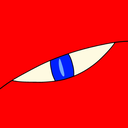

# PokeUDS

PokeUDS trades with retail Pokemon games on a Nintendo 3DS over local wireless (UDS), the way
[pokeldn](https://github.com/Decryptu/pokeldn) does for the Switch. A computer with an ESP32-S3 board or a USB Wi-Fi
adapter stands in for a second console: the 3DS sees another player and trades with it. Nothing is installed on the
3DS. It can also send Gen 6 and Gen 7 Mystery Gifts over local wireless, the way an event distribution did.

**Status: alpha.** Trades have run against retail 3DS consoles for the Virtual Console games, Pokemon X/Y and Sun/Moon,
and a Gen 7 local-wireless Mystery Gift has been received by a retail Sun.

| Game | Trades start in | Record | PokeUDS joins | PokeUDS hosts | Tested with a 3DS |
|---|---|---|:---:|:---:|---|
| Red / Blue / Yellow (VC) | VC link menu, Trade Center | `.pk1` (or `.pk2` through the Time Capsule) | ✓ | ✓ experimental | ✓ Gen 1 trades |
| Gold / Silver / Crystal (VC) | VC link menu, Trade Center or Time Capsule | `.pk2` with mail (or `.pk1`) | ✓ | ✓ experimental | ✓ Gen 2 trades |
| X / Y | PSS | `.pk6` | ✓ | ✓ | ✓ the 3DS asking |
| Omega Ruby / Alpha Sapphire | PSS | `.pk6` | ✓ | ✓ | uses X/Y's values |
| Sun / Moon | Festival Plaza | `.pk7` | ✓ | ✓ | ✓ both directions |
| Ultra Sun / Ultra Moon | Festival Plaza | `.pk7` | ✓ | ✓ | uses Sun/Moon's values |

Local trades never cross a generation (Sun/Moon and USUM trade with each other, as do X/Y and ORAS); Gen 1 and Gen 2
meet in the Time Capsule. To move a Pokemon forward, the Bank migrates Gen 1/2 and Gen 6 Pokemon to Gen 7 the way
Poke Transporter and Pokemon Bank do.

## What it does

- **Trade** with the 3DS asking PokeUDS or PokeUDS asking the 3DS, one Pokemon or a queue of them in one session
  (up to six for the Game Boy games, a box's worth and more for the 3DS games).
- **Bank** every Pokemon received, imported or built: legality checks with PKHeX (one or the whole bank), Time
  Capsule copies, migration to Gen 7, duplicates caught, sprites.
- **Build** a legal Pokemon to offer when you have no file (PKHeX.Core, through a small helper program).
- **Mystery Gift**: PKHeX's official Gen 6/7 cards, `.wc6`/`.wc7` and full files, and a card editor (every field,
  saved as `.udsgift`, exported as `.wc6`/`.wc7`). A card's Pokemon can go into the bank and a trade, or the card
  itself goes out over local wireless as an event distribution did:
  - **Gen 6** (X/Y, ORAS): no extra key; the gift is CRC-checked only.
  - **Gen 7** (Sun/Moon, USUM): the game checks the distributor's OPSSR signature, so PokeUDS signs each card with
    the distributor app's private key. That key is not shipped: the **Gen 7 Mystery Gift Key** card in Settings
    reads it from your own dump of the Gen 7 Local Distributor (00040000001A8900) and keeps it in `rsa_d_key.txt`
    beside `aes_keys.txt`. Retail game dumps hold only the public key.
- **Board**: install the ESP32 firmware (included, nothing to download) from the app.
- **Plugins and language packs**, with an install screen that shows what a plugin's code does.

## Getting it

**Windows:** download `PokeUDS-windows.zip` from the [releases](https://github.com/Gr3nSkyDragon/PokeUDS/releases),
unzip it anywhere and run `PokeUDS/PokeUDS.exe`. Nothing else to install: the pages that use PKHeX (Build, legality,
Mystery Gift) offer to download its helper, about 20 MB, once. The first start takes a few seconds longer while the
app unpacks its window.

**From source** (any OS, Python 3.11 or newer):

```bash
python -m venv .venv
```

```bash
.venv\Scripts\activate
```

```bash
pip install -r requirements-gui.txt
```

```bash
python -m gui
```

On macOS or Linux, activate with `. .venv/bin/activate`. `requirements.txt` alone is enough for the command line.

## What you need

- **A radio** ([docs/hardware.md](docs/hardware.md)):
  - an **ESP32-S3** with [esp32-uds-bridge](https://github.com/Gr3nSkyDragon/VC-Adapter/tree/main/firmware/esp32-uds-bridge)
    firmware 1.8, on its native USB port (PokeUDS includes it: the Board page installs it); any OS; or
  - a **USB Wi-Fi adapter** through legacy **ldnd.exe 0.0.5** (Windows; not the ldnrs revision).
- **`aes_keys.txt`** holding the keyslot 0x2D key (`slot0x2DKeyN`, or `slot0x2DKeyX`, `slot0x2DKeyY` and
  `generatorConstant`): the same file Azahar uses. Set it once in Settings. Only scanning works without it.
- **For Gen 7 Mystery Gift distribution only:** a decrypted dump (`.cxi` or `code.bin`) of the Gen 7 Local
  Distributor, from which Settings extracts the signing key once ([docs/mystery_gift.md](docs/mystery_gift.md)).

## Trading from the app

1. Settings: choose `aes_keys.txt`, and set your trainer (name, TID/SID) for Pokemon you build.
2. Trade: pick the game and the connection (ESP32 board or USB Wi-Fi adapter).
3. Add Pokemon to the trade queue: the **+** row picks from the bank, or Build one, or Add a file.
4. Pick who asks, then Start, and follow the steps the page shows on the 3DS:
   - **VC games**: choose Host (or Join) in the VC link menu, then sit at the Trade Center table.
   - **X/Y, ORAS**: open the PSS with local wireless on, then ask PokeUDS for a trade (or accept its request).
   - **Sun/Moon, USUM**: open the Festival Plaza, then invite PokeUDS to a Link Trade (or accept its invite).

What the 3DS sends lands in the bank. See [docs/gui.md](docs/gui.md) for every page.

## Sending a Mystery Gift

1. Gifts: pick an official card (PKHeX's list), open a `.wc6`/`.wc7`/full file, or make one in the editor.
2. For Sun/Moon or USUM, set up the Gen 7 Mystery Gift Key in Settings first (once).
3. Send over local wireless, then on the 3DS: Mystery Gift, Receive Gift, Get via Local Wireless.

## The command line

```bash
python -m pokeuds scan --radio esp32 --seconds 30
```

```bash
python -m pokeuds trade sm --radio esp32 --offer my.pk7
```

```bash
python -m pokeuds trade xy --role host --radio esp32 --offer my.pk6 --partner Serena
```

```bash
python -m pokeuds vc trade --radio esp32 --offer my.pk1
```

```bash
python -m pokeuds gift distribute sm my.wc7 --radio esp32
```

`--offer` repeats for a queue; `--keys` defaults to the app's Settings; `-v` (before the command) shows what happens.
`scan` lists every 3DS network in range, `analyze` decodes an Azahar log or a capture, `build` makes a Pokemon with
PKHeX, `gift` lists, edits, builds and distributes Mystery Gift cards (`--gen7-key` points at `rsa_d_key.txt` if it
is not beside `aes_keys.txt`), `board` manages the ESP32, `pkhex` gets the PKHeX helper, `plugins` manages plugins.
`python scripts/extract_gen7_key.py DISTRIBUTOR.cxi --keys aes_keys.txt` is the Settings key extraction from a
terminal. Each game's protocol is in
[docs/vc.md](docs/vc.md), [docs/gen6.md](docs/gen6.md) and [docs/gen7.md](docs/gen7.md).

## Layout

| Path | Contents |
|---|---|
| `pokeuds/radio/` | The ESP32 serial protocol, the ldnd pipe and nl80211 monitor, radiotap, a simulated air |
| `pokeuds/uds/` | 802.11 frames, beacons, CCMP and key derivation, SecureData, EAPoL, the station (host and client), the sniffer |
| `pokeuds/nex/` | NEX's PRUDP V1 as Gen 6/7 run it over Pia's local UDS layer |
| `pokeuds/games/` | Game registry and profiles; `gen6/` the PSS and X/Y-ORAS trade, `gen7/` the Festival Plaza and Sun/Moon-USUM trade |
| `pokeuds/vc/` | Virtual Console: Pia frames and session, the Game Boy trade engine |
| `pokeuds/pkx.py`, `gbpk.py` | Gen 6/7 and Gen 1/2 records, the Time Capsule conversions |
| `pokeuds/capture/` | Azahar-log and sniff transcripts, the protocol decoders behind `analyze` |
| `pokeuds/games/gen6/delivery.py`, `gen7/delivery.py` | Local-wireless Mystery Gift: the beacon fragments, LZ10, Gen 7's OPSSR signing |
| `gui/`, `pokeuds/app/` | The app (Flet) and what it shares with the command line; `gui/assets/` holds the icon |
| `packaging/`, `scripts/build_exe.py` | The Windows exe's entry point, the icon artwork and the build ([docs/release.md](docs/release.md)) |
| `services/pkhex/` | The PKHeX helper: building and checking Pokemon, Mystery Gift cards, migration |
| `profiles/` | Each game's network constants, from captures |
| `docs/` | [The app](docs/gui.md), [architecture](docs/architecture.md), [UDS](docs/uds.md), [Gen 6](docs/gen6.md), [Gen 7](docs/gen7.md), [Virtual Console](docs/vc.md), [hardware](docs/hardware.md), [captures](docs/captures.md), [PKHeX helper](docs/pkhex.md), [Mystery Gift](docs/mystery_gift.md), [Wonder Cards](docs/wonder_cards.md), [plugins](docs/plugins.md), [releases](docs/release.md) |

```bash
python -m pytest -q
```

## Credits and licensing

The UDS layer is a Python port of the physical-UDS work in [azahar_uds](https://github.com/Gr3nSkyDragon/azahar_uds)
(built on Citra/Azahar's NWM emulation, GPLv2 or later), so PokeUDS must stay GPL-compatible; no license file has been
chosen yet. The Gen 6/7 protocols were read off Azahar logs of retail trades. Pokemon records, legality, Mystery Gift
cards and migration come from [PKHeX](https://github.com/kwsch/PKHeX). The Virtual Console support builds on
Gr3nSkyDragon's VC link measurements ([mgba_LDN](https://github.com/Gr3nSkyDragon/mgba_LDN)) and
[pret](https://github.com/pret)'s pokered and pokecrystal. Sprites: [PokeAPI](https://github.com/PokeAPI/sprites).
The overall shape follows pokeldn. ESP32 firmware: Gr3nSkyDragon's VC-Adapter. ldnd: unlimitedcoder2.
The Gen 7 Mystery Gift support was developed with **DeepSeek Harness** (DeepSeek); see
[CONTRIBUTORS.md](CONTRIBUTORS.md).
