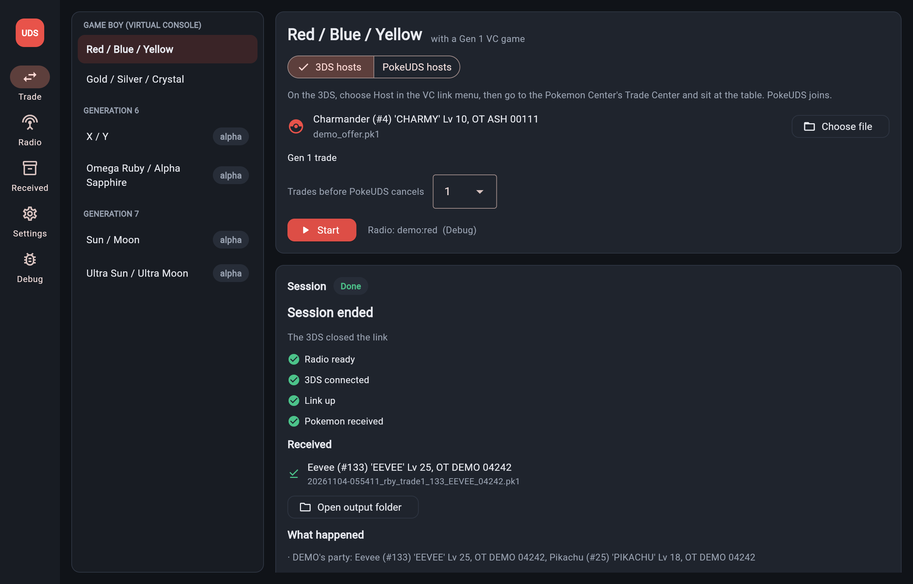

# The app

```bash
pip install -r requirements-gui.txt
```

```bash
python -m gui
```

A desktop app (Flet 1.0.5, the toolkit pokeldn uses) over the same code as the command line.



## Pages

The window opens where it was last closed, at the same size (and maximized if it was); the first time, or
when that place is no longer on any screen, it opens centered (`gui/window.py`, Settings' `window`).


The rail lists Trade, Bank and Gifts at the top, and Plugins, Board, Debug (when it is on) and Settings at
its foot, Settings last. Plugin tools appear on the Trade page under their game. The app says "ESP32" for the board: esp32-uds-bridge runs on the ESP32-S3 today, and
other chips can join the firmware list later without renaming anything.

| page | what it does |
|---|---|
| Trade | pick the game, who hosts, the Pokemon to offer, the connection, Start; the session panel follows the run: radio, 3DS connected, link up, Pokemon received, what happened, the log |
| Bank | every Pokemon the app keeps, received ones included: details, PKHeX legality, offer in a trade, Time Capsule copy, import, export, delete |
| Gifts | Gen 6/7 Mystery Gift cards: PKHeX's official events, a `.wc6`/`.wc7` (or full) file, or a custom card from the editor (every field, Customize any card, save as `.udsgift`, export `.wc6`/`.wc7`); the card's Pokemon into the bank and a trade; a Gen 6 or Gen 7 card sent over local wireless as an event distribution did (Gen 7 signed with the key from Settings) (Send over local wireless: Mystery Gift, Get via Local Wireless on the 3DS) (docs/mystery_gift.md, docs/wonder_cards.md) |
| Debug | only with Settings, Debug tools on: the demo radio, a network scan, capture analysis |
| Plugins | installed plugins: on and off, update, remove, add from a file or a followed source, the install screen (docs/plugins.md) |
| Board | ESP32 boards (the S3 today): their firmware and build, install the included esp32-uds-bridge 1.8 (GB-Link build), Use for trades (`board ...` children; docs/hardware.md) |
| Settings | `aes_keys.txt`, the Gen 7 Mystery Gift Key (extracted from your Gen 7 Local Distributor dump into `rsa_d_key.txt`), the output folder, the trainer name the 3DS sees, the app language (English or an installed language pack), Debug tools |

On the Trade page:

- **The trade queue** is what PokeUDS offers, one Pokemon per trade, in order; it leaves after the last. The **+**
  row opens a list of the bank's Pokemon the game takes (a search, sprites; Gen 7 lists the Gen 1, 2 and 6 ones it
  migrates first): a click queues one and the list stays open for more. Its Open the Bank page shows the whole
  bank, where a double click queues a Pokemon and comes back. Build one and Add a file (several at once) queue
  too; each row moves up or down or comes out, and Clear the queue empties it. A Virtual Console session trades up to six (a Game Boy party), all `.pk1` or all `.pk2`; a
  3DS game as many as its boxes and party hold. Each game keeps its own queue (Settings' `offers` and `queued`).

- **The offer** comes from the bank, from a file, or from **Build one**: the builder opens under the
  buttons, for the chosen game; PKHeX builds a legal Pokemon from your wishes (species, level, nickname,
  shiny, gender, nature, ability, item, ball, moves) and the trainer, it is kept in the bank and becomes
  the offer (docs/pkhex.md).
- **The connection**, as pokeldn's Connection choice: the ESP32 board (found by its USB id, or the
  port the Board page set with Use for trades) or a USB Wi-Fi adapter through ldnd.exe 0.0.5 (Windows,
  with its pipe). Check runs `probe` and shows what answered. With the Debug demo radio on, the row says
  so instead.

The Game Boy titles and X/Y and ORAS trade completely; for Gen 6 the roles read "3DS asks" and
"PokeUDS asks", since in the PSS whoever asks for the trade hosts it (docs/gen6.md). Sun/Moon and
Ultra Sun/Ultra Moon are marked alpha: a run joins or hosts and records what the 3DS sends, and Start
stays off until the game's profile has the values captures provide (`profiles/<game>.toml`).

## How it runs a trade

As in pokeldn, the app never opens the radio itself. Start runs the command line as a child process
(`python -m pokeuds vc trade ...`, or `trade xy ...`) with `POKEUDS_STATUS=1`, and reads two kinds of
line from it: the plain log, and `[status] {...}` events (`pokeuds/status.py`) that drive the session
panel. Stop closes the child's stdin, which the child turns into a clean shutdown (it leaves the
session and closes the radio); a child that does not end is terminated after a few seconds. One run
at a time, since one radio serves one process.

| module | role |
|---|---|
| `pokeuds/app/settings.py` | settings in the platform data folder (`POKEUDS_DATA` overrides it) |
| `pokeuds/app/catalog.py` | the games the app lists, what each accepts, the command it runs, what blocks Start |
| `pokeuds/app/runner.py` | the child process |
| `pokeuds/app/progress.py` | events to headline, steps and notes |
| `pokeuds/app/board.py` | boards, the included firmware, flashing |
| `pokeuds/app/bank.py` | the bank folder |
| `pokeuds/app/builder.py` | the builder's wishes and trainer (Trade page, Build one) |
| `gui/` | the Flet pages |

## The bank

The bank is a folder holding one file per Pokemon (`pokeuds/app/bank.py`). What the app knows about each one is a
`.json` of the same name in the hidden `.info` folder inside, so the folder itself shows only Pokemon (and a Gen 2
Pokemon's `.mail`, which trades read beside its `.pk2`); a bank from before `.info` is tidied into it when opened.
The packaged Windows app keeps it in `Bank` beside PokeUDS.exe, which the release zip never contains, so an update
unzipped over the app's folder leaves it alone; on its first start it copies the records of an older `<data
folder>/bank` there (the old folder stays). The Mac app, whose bundle an update replaces whole, keeps it in
`~/Library/Application Support/PokeUDS/bank`. From source, or when the exe's folder cannot be written, it is `<data
folder>/bank`. Settings' `bank` overrides both.

```
20261104-153012_025_Sparky_1a2b3c4d.pk6          the record: .pk1/.pk2 as PokeUDS writes them, .pk6/.pk7 decrypted and stored, as PKHeX opens them
20261104-153012_025_Sparky_1a2b3c4d.mail         a Gen 2 Pokemon's mail, when it holds one
.info/20261104-153012_025_Sparky_1a2b3c4d.json   source (received, imported, built, converted, gift, migrated), when, the file it came from, a note, PKHeX's verdict
.info/received.json                              the received files already deposited
```

- **Received Pokemon** still land in the output folder first (one file per trade, as before). Each time
  the Bank page opens, files there that it has not seen are deposited; one deleted from the bank is not
  brought back (`.info/received.json` remembers what was seen).
- **One copy each:** a Pokemon already banked is not added again, whatever its file name, and also after a trade there and back: what a trade writes into a record (Gen 6/7: the handling trainer, geolocations, memories, friendship and affection, the checksum; Gen 2: friendship) does not count. Anything else does, so a Pokemon that levelled up, learned a move or evolved is a new entry. Copies banked before this check existed show a **Remove duplicates** button, which keeps the oldest copy of each and moves an offer on a removed copy to it.
- **Import** takes `.pk1`, `.pk2`, `.pk6`, `.pk7`, `.ek6` and `.ek7` (encrypted records are stored decrypted),
  with a `.pk2`'s `.mail` beside it.
- **Add to a trade queue** lists the games that take the record (a `.pk1` or `.pk2` reaches both VC games,
  the Time Capsule converting it on the way; a `.pk6` X/Y and ORAS; a `.pk7` Sun/Moon and Ultra Sun/Ultra
  Moon) and adds it to that game's trade queue. On the Trade page, **From the bank** opens the bank showing only
  what the chosen game takes.
- **Time Capsule copy** banks the `.pk2` a Gen 1 Pokemon becomes in Gen 2, or the `.pk1` a Gen 2 one
  becomes in Gen 1 (a Gen 1 species with Gen 1 moves only; its item and mail stay behind).
- **Check** asks PKHeX (docs/pkhex.md) and keeps the answer with the record.
- **Check all** (the header) checks every record in turn, with a Stop button; the illegal ones are then shown
  through the **Not legal** filter.
- **Migrate to .pk7** makes the copy Poke Transporter (a `.pk1`/`.pk2`) or Pokemon Bank (a `.pk6`) would bring
  into Sun/Moon and Ultra Sun/Ultra Moon, through PKHeX.Core's own versions of those apps (docs/pkhex.md). The
  original stays in the bank as it was; the copy is a `.pk7` from then on and goes to Gen 7 games only. A record is
  migrated once: asking again shows the copy made the first time (a second one would have other IVs and PID).
  A Gen 1/2 Pokemon asks which Virtual Console game it is transferred from, as Transporter reads one game's save.
  The Gen 7 offer buttons on a Gen 1/2/6 record (**Offer in Sun / Moon (migrates to .pk7)**) and choosing
  **From the bank** for a Gen 7 game do the same: the Gen 1, 2 and 6 Pokemon are listed, and picking one asks
  first, migrates it, and offers the copy. Nothing official goes from the Game Boy to Gen 6, or back from Gen 7,
  so PokeUDS does not either.

Levels of stored Gen 6/7 records (which carry no level byte) come from their experience and the species'
growth rate (`pokeuds/species.py`, taken from PKHeX.Core).

## Pokemon sprites

The builder's preview, the bank (each row and the chosen Pokemon) and Mystery Gift (each card and the gift)
show the Pokemon's sprite, shiny when it is. They come from PokeAPI's sprite collection
(github.com/PokeAPI/sprites, as pokeldn's app gets its own): none ship with PokeUDS; each is downloaded the
first time it is shown and kept in `<data>/sprites` (`normal/`, `shiny/`). Gen 6/7 forms with a look of their
own (Alolan forms, Unown's letters, Rotom, Arceus's types...) get theirs; other forms show the species.

A sprite is never needed: offline, the preview keeps a placeholder and the app does not ask again for a minute;
a sprite PokeAPI does not have is not asked for again for a week. Only a small, plain PNG is kept, rebuilt from
the chunks that draw it. **Settings > Pokemon sprites** turns downloading off; the sprites already kept still show.
Code: `pokeuds/app/sprites.py` (the cache), `gui/views/sprite.py` (the preview).

## The demo radio

Debug, Demo radio, picks a simulated 3DS (Red, Yellow, Gold, Gold in the Time Capsule, Crystal). Runs then
go to `--radio demo:<title>`: a modelled console hosting from the VC link menu, on a simulated air, through
the real UDS, Pia and Game Boy code. It is for trying the app and for development, and proves nothing
about a real console. It needs no console keys.

## Screenshots

`POKEUDS_GUI_WEB=8550 python -m gui` serves the app to a browser instead of opening a window. Add `POKEUDS_GUI_HOST=0.0.0.0` to
reach it from another machine (a phone on the same network, a preview pane); it has no login, so only
do that on a network you trust.
