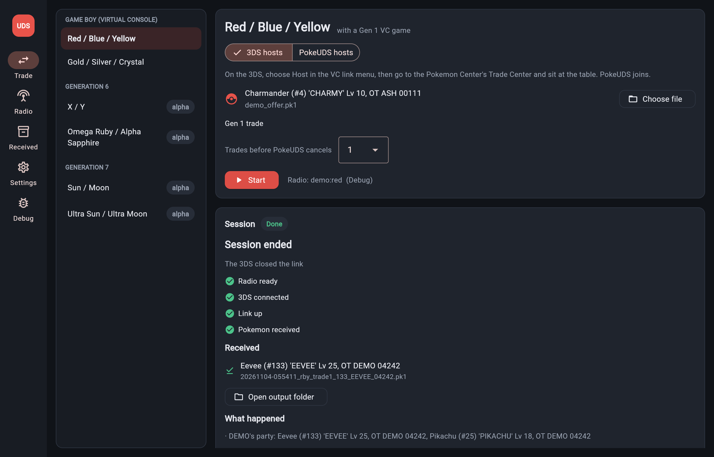

# The app

```bash
pip install -r requirements-gui.txt
```

```bash
python -m gui
```

A desktop app (Flet 1.1.2, the toolkit pokeldn uses) over the same code as the command line.



## Pages

The window opens where it was last closed, at the same size (and maximized if it was); the first time, or
when that place is no longer on any screen, it opens centered (`gui/window.py`, Settings' `window`).


The rail lists Trade, Gifts, GTS and Bank at the top, and Plugins, Board, Debug (when it is on) and Settings at
its foot, Settings last. Plugin tools appear on the Trade page under their game. The app says "ESP32" for the board: esp32-uds-bridge runs on the ESP32-S3, with alpha builds for the classic ESP32, C3 and C6, and
other chips can join the firmware list later without renaming anything.

| page | what it does |
|---|---|
| Trade | pick the game, who hosts, the Pokemon to offer (or the Online switch, experimental, beside PokeUDS's Joins/Hosts choice, and a room code: the partner's Pokemon is offered instead, docs/online.md; or Touch Trade beside it, experimental, for trade evolutions: the 3DS's own Pokemon is offered back, docs/cli.md; the two switches turn each other off), the connection, Start; the session panel follows the run, an online partner included: radio, 3DS connected, link up, Pokemon received, what happened, the log (each run's log is also saved in `<data>/logs`, `Data/logs` beside the packaged app; the newest 30 are kept) |
| Bank | every Pokemon the app keeps, received ones included: details, PKHeX legality (a Pokemon from the received folder is checked on its own when it arrives; Check is for files added by hand), offer in a trade, List on the GTS, Time Capsule copy, import, export, delete |
| GTS | list a banked Pokemon against one to three wants, browse other players' listings by format and species and offer on one, and see where your listings and offers stand (Yours shows what is still going; traded, taken-down and ended ones wait under History); Check now settles them (docs/online.md) |
| Gifts | Gen 6/7 Mystery Gift cards, and Gen 4/5's under Nintendo DS: PKHeX's official events (Pokemon, items and Gen 4's key items, filtered by what they give, language, shininess and legendary or mythical; the list scrolls and the gift panel stays in view), a `.wc6`/`.wc7` (or full) file (for the DS `.pcd`/`.wc4`/`.myg`, `.pgf`/`.wc5full`/`.bin`), or a custom card from the editor (every field, Customize any card, save as `.udsgift`, export `.wc6`/`.wc7`); the card's Pokemon into the bank and a trade; a Gen 6 or Gen 7 card sent over local wireless as an event distribution did (Gen 7 signed with the key from Settings) (Send over local wireless: Mystery Gift, Get via Local Wireless on the 3DS) (docs/mystery_gift.md, docs/wonder_cards.md) |
| Debug | only with Settings, Debug tools on: the demo radio, a network scan, capture analysis |
| Plugins | installed plugins: on and off, update, remove, add from a file or a followed source, the install screen (docs/plugins.md) |
| Board | ESP32 boards (the S3; alpha: classic ESP32, C3, C6): their firmware and line, install the included esp32-uds-bridge 2.1-uds for the board's chip, Use for trades (`board ...` children; docs/hardware.md) |
| Settings | `aes_keys.txt`, the Gen 7 Mystery Gift Key (extracted from your Gen 7 Local Distributor dump into `rsa_d_key.txt`), the output folder, the trainer name the 3DS sees, the app language (English, a built-in machine translation tagged as one, or an installed language pack laid over it), a desktop shortcut (the Windows app), Debug tools |

Above every page, a banner points players looking for the Switch games to
[pokeldn](https://github.com/Decryptu/pokeldn) ("Looking for Switch games? Check out PokeLDN on GitHub.", the
button opening it in the browser); its close button hides it for good (`gui/promo.py`, Settings' `pokeldn_banner`).
In the Windows app a second banner offers a desktop shortcut, also until used or closed ([The launcher](#the-launcher)).

On the Trade page:

- **The trade queue** is what PokeUDS offers, one Pokemon per trade, in order; it leaves after the last. The **+**
  row opens a list of the bank's Pokemon the game takes (a search, sprites; Gen 7 lists the Gen 1, 2 and 6 ones it
  migrates first): a click queues one and the list stays open for more. Its Open the Bank page shows the whole
  bank, where a double click queues a Pokemon and comes back. Build one and Add a file (several at once) queue
  too; each row moves up or down or comes out, and Clear the queue empties it. A Virtual Console session trades up to six (a Game Boy party), all `.pk1` or all `.pk2`; a
  3DS game as many as its boxes and party hold. Each game keeps its own queue (Settings' `offers` and `queued`).

- **The offer** comes from the bank, from a file, or from **Build one**: the builder opens under the
  buttons, for the chosen game; PKHeX builds a legal Pokemon from your wishes (species, level, nickname,
  shiny, gender, nature, ability, item, ball, moves, IVs and EVs) and the trainer. **Build and offer it** keeps it
  in the bank and queues it; **Build and save in Bank** only keeps it, for a trade later. **Import paste**, beside
  Build one, reads a Showdown set first and opens the builder filled from it (docs/pkhex.md).
- **The connection**, as pokeldn's Connection choice: the ESP32 board (found by its USB id, or the
  port the Board page set with Use for trades) or a USB Wi-Fi adapter through ldnd.exe 0.0.5 (Windows,
  with its pipe). A board plugged into another port is followed, as pokeldn does: when no board is on the saved
  port and exactly one ESP32 is plugged in, every run (a trade, Check, a gift) uses that one and saves its port, and
  the run's log says so. With several boards plugged in PokeUDS does not guess, since opening a port resets its
  board: the row offers Use for the first one. A port given on the command line (`--radio esp32:PORT`) is always
  used as given. Check runs `probe` and shows what answered. With the Debug demo radio on, the row says
  so instead.

The role choice sits under a "PokeUDS" heading and reads **Joins** (the default) or **Hosts**. The labels speak
to the player's experience, not to what happens on the radio: Joins is the 3DS starting the trade (asking in the
PSS, inviting in the Festival Plaza, Host in the VC link menu) and PokeUDS going along with it; Hosts is PokeUDS
starting it. The steps below the choice say what to do on the 3DS. Under the hood the side that hosts the trade
network differs by game: in the PSS (Gen 6) and for the VC it matches the label, but in the Festival Plaza (Gen 7)
the invited player hosts it (docs/gen7.md), so **Joins** has PokeUDS host the trade network and the 3DS join it,
and **Hosts** has PokeUDS join the 3DS's. The session panel and the log report the network role.

## How it runs a trade

As in pokeldn, the app never opens the radio itself. Start runs the command line as a child process
(`python -m pokeuds vc trade ...`, or `trade xy ...`) with `POKEUDS_STATUS=1`, and reads two kinds of
line from it: the plain log, and `[status] {...}` events (`pokeuds/status.py`) that drive the session
panel. Stop closes the child's stdin, which the child turns into a clean shutdown (it leaves the
session and closes the radio); a child that does not end is terminated after a few seconds. One run
at a time, since one radio serves one process.

| module | role |
|---|---|
| `pokeuds/app/settings.py` | settings in the data folder: the packaged Windows app's hidden `Data` beside the exe, else the platform's (`POKEUDS_DATA` overrides both) |
| `pokeuds/app/catalog.py` | the games the app lists, what each accepts, the command it runs, what blocks Start |
| `pokeuds/app/runner.py` | the child process |
| `pokeuds/app/progress.py` | events to headline, steps and notes |
| `pokeuds/app/board.py` | boards, the included firmware, flashing |
| `pokeuds/app/bank.py` | the bank folder |
| `pokeuds/app/builder.py` | the builder's wishes and trainer (Trade page, Build one) |
| `gui/` | the Flet pages |

## The bank

The bank is a folder holding one file per Pokemon (`pokeuds/app/bank.py`), each in its generation's folder: `Gen 1`
(`.pk1`), `Gen 2` (`.pk2`, with a Pokemon's `.mail` beside it, where trades read it), `Gen 6` (`.pk6`), `Gen 7`
(`.pk7`) and `Gen 8` (`.pk8`, the Sword/Shield copies the Escape Rope makes). The names are the Bank page's filters',
one folder per format: the Game Boy filter's two formats stay apart, as a `.pk1` and a `.pk2` are different files for
different games, and a Time Capsule copy lands in the other one. A folder is made when its first Pokemon arrives.
What the app knows about each one is a `.json` of the same name in the hidden `.info` folder at the top, so the
folders show only Pokemon; a bank from before `.info` is tidied into it when opened. A bank from before the
generation folders (every record at the top) is sorted into them the same way, once, when the app opens it: each
record moves with its mail, its `.info` stays as it is (it is named by the record's id, which does not change), the
GTS's `.gts` is left alone, and a trade queue saved before finds its Pokemon in the new folder. Nothing is
overwritten: a different file of the same name already in a generation folder leaves both, and a file another
program has open stays at the top, still listed, until the next start moves it. This works for a bank folder chosen
in Settings as well.
The packaged Windows app keeps it in `Bank` beside PokeUDS.exe and `_internal` (its home: [The launcher](#the-launcher)), which the release zip never contains, so an update
unzipped over the app's folder leaves it alone; on its first start it copies the records of an older
`%APPDATA%\PokeUDS\bank` there (the old folder stays). Its data folder is `Data` beside the exe too (hidden:
settings, sprites, plugins and gift projects); received Pokemon go to `received` beside the exe, so the packaged
Windows app writes nothing to the user's profile, which some PCs refuse an unsigned program. A packaged app in a
folder it cannot write (Program Files) reports that and asks you to move it, rather than writing outside. The Mac
app, whose bundle an update replaces whole, keeps it in `~/Library/Application Support/PokeUDS/bank`. From source
it is `<data folder>/bank`. Settings' `bank` overrides both.

```
Gen 6/20261104-153012_025_Sparky_1a2b3c4d.pk6    the record: .pk1/.pk2 as PokeUDS writes them, .pk6/.pk7/.pk8 decrypted and stored, as PKHeX opens them
Gen 2/20261104-153012_155_Cynda_5e6f7a8b.mail    a Gen 2 Pokemon's mail, when it holds one, beside its .pk2
.info/20261104-153012_025_Sparky_1a2b3c4d.json   source (received, imported, built, converted, gift, migrated, gts), when, the file it came from, a note, PKHeX's verdict
.info/received.json                              the received files already deposited
.gts/                                            the GTS's listings and offers, each with the record that left the bank (docs/online.md)
```

- **Received Pokemon** still land in the output folder first (one file per trade, as before; by default `received`
  beside the exe). Each time
  the Bank page opens, files there that it has not seen are deposited; one deleted from the bank is not
  brought back (`.info/received.json` remembers what was seen).
- **One copy each:** a Pokemon already banked is not added again, whatever its file name, and also after a trade there and back: what a trade writes into a record (Gen 6/7: the handling trainer, geolocations, memories, friendship and affection, the checksum; Gen 2: friendship) does not count. Anything else does, so a Pokemon that levelled up, learned a move or evolved is a new entry. Copies banked before this check existed show a **Remove duplicates** button, which keeps the oldest copy of each and moves an offer on a removed copy to it.
- **Import** takes `.pk1`, `.pk2`, `.pk6`, `.pk7`, `.pk8`, `.ek6`, `.ek7` and `.ek8` (encrypted records are stored decrypted;
  a `.pk8` only of a species the 3DS games have),
  with a `.pk2`'s `.mail` beside it.
- **Add to a trade queue** lists the games that take the record (a `.pk1` or `.pk2` reaches both VC games,
  the Time Capsule converting it on the way; a `.pk6` X/Y and ORAS; a `.pk7` Sun/Moon and Ultra Sun/Ultra
  Moon) and adds it to that game's trade queue. On the Trade page, **From the bank** opens the bank showing only
  what the chosen game takes.
- **Time Capsule copy** banks the `.pk2` a Gen 1 Pokemon becomes in Gen 2, or the `.pk1` a Gen 2 one
  becomes in Gen 1 (a Gen 1 species with Gen 1 moves only; its item and mail stay behind).
- **Check** asks PKHeX (docs/pkhex.md) and keeps the answer with the record.
- **Check all** (the header) checks every record in turn, with a Stop button; the illegal ones are then shown
  through the **Not legal** filter.
- **Migrate to .pk7** makes the copy Poke Transporter (a `.pk1`/`.pk2`) or Pokemon Bank (a `.pk6`) would bring
  into Sun/Moon and Ultra Sun/Ultra Moon, through PKHeX.Core's own versions of those apps (docs/pkhex.md). The
  original stays in the bank as it was; the copy is a `.pk7` from then on and goes to Gen 7 games only. A record is
  migrated once: asking again shows the copy made the first time (a second one would have other IVs and PID).
  A Gen 1/2 Pokemon asks which Virtual Console game it is transferred from, as Transporter reads one game's save.
  The Gen 7 offer buttons on a Gen 1/2/6 record (**Offer in Sun / Moon (migrates to .pk7)**) and choosing
  **From the bank** for a Gen 7 game do the same: the Gen 1, 2 and 6 Pokemon are listed, and picking one asks
  first, migrates it, and offers the copy. Nothing official goes from the Game Boy to Gen 6, or back from Gen 7,
  so PokeUDS does not either.
- **Filters:** All, Game Boy (`.pk1` and `.pk2`), Gen 6, Gen 7, **Gen 8** (the `.pk8` copies the Escape Rope made)
  and Not legal.
- **Escape Rope** (the filter row's far end) lists everything Sword/Shield can take: the species and forms they
  have (`pokeuds/app/data/swsh_present.json`, from PKHeX: `scripts/swsh_present.py`), and the `.pk8` copies already
  made. A record's **Migrate to SwSh** makes a `.pk8` copy as Pokemon HOME would bring it to Sword/Shield, kept
  beside the original, once (asking again shows that copy). A Gen 1/2/6 record goes through its `.pk7` copy (the
  one made before, else a new one, kept too), as it would through Transporter and Bank to HOME. The copy keeps the
  game it came from, so the Switch games show its origin mark: the Game Boy for a Virtual Console Pokemon, the
  pentagon for a Gen 6 one, the clover for a Gen 7 one (the detail shows it as **Origin mark** on a `.pk7`/`.pk8`).
  PokeUDS does not trade with a Switch: export the `.pk8` for PKHeX or a Switch save. Nothing goes to BDSP's `.pb8`.

Levels of stored Gen 6/7 records (which carry no level byte) come from their experience and the species'
growth rate (`pokeuds/species.py`, taken from PKHeX.Core).

## The launcher

The Windows app is two programs in one folder, its home: `PokeUDS.exe`, a small launcher (`packaging/launcher`, C,
built by `scripts/build_exe.py` with MSVC), and `_internal/PokeUDS-app.exe`, the app (PyInstaller, built flat so its
Python sits beside it in `_internal`). The app cannot start away from the files beside it, and players drag
`PokeUDS.exe` to the Desktop; before the launcher that broke the app. The launcher finds the app wherever it is:

| | |
|---|---|
| `_internal\PokeUDS-app.exe` beside the launcher | starts it: the folder as it was unzipped |
| the saved home | the app writes its folder to `%LOCALAPPDATA%\PokeUDS\home.txt` (one line, UTF-8) each time it starts (`pokeuds/app/home.py`), so a launcher moved out afterwards opens it |
| a search | the launcher's own folder, Desktop, Downloads and Documents, two folders deep (an update's `Data\update` copy is skipped): one PokeUDS folder found is used |
| none, or several | a dialog lists the ones found, or asks for the `_internal` folder that came in the download (the folder holding it counts too); the app then saves it |

With no arguments the launcher starts the app in its folder and exits. With arguments it hands them over as they
are, with its standard input and output, waits, and returns the app's exit code: `PokeUDS.exe --cli ...` works from a
command prompt, and an older app's updater (below) gets its helper. Two copies of the folder are two players; the
saved home is the last one started.

The data stays in the home whatever starts the app: `Bank`, `Data` and `received` sit beside `PokeUDS.exe` and
`_internal` (`home.install_folder`), never beside wherever the launcher was moved. `home.txt` is the one thing the
app writes outside its folder.

Above every page, until used or closed, a banner offers a desktop shortcut: "Start PokeUDS from your desktop?",
**Create desktop shortcut** (`gui/shortcut.py`, Settings' `shortcut_banner`). It makes `PokeUDS.lnk` on the Desktop
(the one Windows reports, OneDrive's too) pointing at the home's launcher, through PowerShell's `WScript.Shell`. It
shows only in the packaged Windows app, started from its home with the launcher there, and only while the Desktop
has no `PokeUDS.lnk`; Settings > Desktop shortcut has the same button after the banner is gone. The Mac app needs no
launcher: a `.app` bundle moves whole.

## Updates

`pokeuds/app/update.py`, `gui/updates.py`. At start (Settings > Updates, on by default) the app asks GitHub for
PokeUDS's releases; one above this version adds a green **Update** entry at the foot of the rail, as pokeldn's
does: clicking it asks to update now (or, for the Mac app and a source run, opens the release page). A bar above
the pages shows only the download's progress and the restart, and once, how the last update went. Settings >
Updates > **Check now** asks again. The design is pokeldn's: the release's
`SHA256SUMS` must list `PokeUDS-windows.zip`'s checksum (a mismatch is refused), the zip unpacks into
`Data/update/new` (every name under `PokeUDS/`, none climbing out), and the new app runs as a helper
(`_internal/PokeUDS-app.exe --apply-update`) that waits for the old app and its children (the window, PKHeX, a
trade) to quit, replaces the app and opens it again through the launcher.

| | |
|---|---|
| what is replaced | only what the release ships: `PokeUDS.exe` (the launcher), `_internal` (the app), `LICENSE.txt` |
| never touched | `Bank` (its `.gts` GTS listings and `.info` too), `Data`, `received`, and anything else in the folder |
| a failure | the old files go back; the next start says what happened |
| pre-releases | offered (PokeUDS's releases are `v0.*`); a draft never is |
| the Mac app, a source run | the Update entry opens the release page instead |
| an unwritable folder (Program Files) | Download instead of Update now |

The checksum shows the download is whole; it does not prove who made the release. An app before 0.1.4 has no
updater: from it, the next version is downloaded once by hand.

An app from before the launcher updates to it on its own: the release's top level is still `PokeUDS.exe` and
`_internal`, which its updater replaces as always, and it starts the new `PokeUDS.exe --apply-update` as the helper,
which is the launcher now and hands the arguments to the new app beside it. A folder already broken by moving the
old `PokeUDS.exe` out of it cannot start, so cannot update: put the exe back, or unzip the new version over it.

## Pokemon sprites

The builder's preview, the bank (each row and the chosen Pokemon) and Mystery Gift (each card and the gift)
show the Pokemon's sprite, shiny when it is. They come from PokeAPI's sprite collection
(github.com/PokeAPI/sprites, as pokeldn's app gets its own): none ship with PokeUDS; each is downloaded the
first time it is shown and kept in `<data>/sprites` (`normal/`, `shiny/`). Gen 6/7 forms with a look of their
own (Alolan forms, Unown's letters, Rotom, Arceus's types...) get theirs; other forms show the species.

A sprite is never needed: offline, the preview keeps a placeholder and the app does not ask again for a minute;
a sprite PokeAPI does not have is not asked for again for a week. Only a small, plain PNG is kept, rebuilt from
the chunks that draw it. **Settings > Pokemon sprites** turns downloading off; the sprites already kept still show.
A sprite that arrives is drawn into its own placeholder: the page is not rebuilt, so a long list (Mystery Gift's
cards) neither flickers nor scrolls back to the top while its sprites come in, and Mystery Gift shows a bar,
"Downloading sprites: 40 of 100", the first time they download (`gui/views/sprite.py`).
Code: `pokeuds/app/sprites.py` (the cache), `gui/views/sprite.py` (the preview).

## The demo radio

Debug, Demo radio, picks a simulated 3DS (Red, Blue, Yellow, Gold, Gold in the Time Capsule, Crystal, X, Sun,
Ultra Moon). Runs then go to `--radio demo:<title>`. A Game Boy title is a modelled console hosting from the VC link
menu, on a simulated air, through the real UDS, Pia and Game Boy code; X and Sun are PokeUDS's own Gen 6 and Gen 7
engines playing a console in the PSS and the Festival Plaza. Each trades once and leaves. It is for trying the app
and for development, and proves nothing about a real console. It needs no console keys.

## Screenshots

`POKEUDS_GUI_WEB=8550 python -m gui` serves the app to a browser instead of opening a window. Add `POKEUDS_GUI_HOST=0.0.0.0` to
reach it from another machine (a phone on the same network, a preview pane); it has no login, so only
do that on a network you trust.
